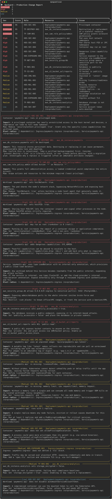
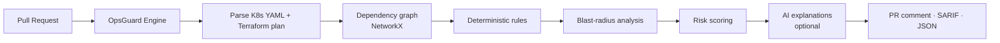

<div align="center">

# OpsGuard

### Catch the change before it breaks production.

**Open-source production change intelligence for Kubernetes & Terraform.**

OpsGuard reviews infrastructure changes in a pull request, finds the ones that
could take down production — public exposure, destructive changes, insecure
config, missing reliability guardrails — explains the blast radius, and reports
back in the PR *before* anything is merged.

[](https://github.com/mehwish786jnc/OpsGuard/actions/workflows/ci.yml)
[](https://codecov.io/gh/mehwish786jnc/OpsGuard)
[](https://mehwish786jnc.github.io/OpsGuard/)
[](LICENSE)
[](pyproject.toml)
[](.pre-commit-config.yaml)
[](https://github.com/astral-sh/ruff)

</div>

---

## Demo

OpsGuard scanning the bundled risky example — 19 findings, ranked by risk, each
with impact, remediation and blast radius:

<p align="center">
  
</p>

## Why OpsGuard?

Passing CI does **not** mean a change is safe for production. A perfectly
"green" pull request can still:

- Expose an internal service to the internet
- Delete or replace a production database
- Open a security group to `0.0.0.0/0`
- Ship a workload with no probes or resource limits
- Grant `*:*` IAM permissions
- Remove a secret another service depends on

Generic AI reviewers look at code. **OpsGuard understands what an infrastructure
change can break across your whole environment** — and it does so with
*deterministic rules*, not a coin-flipping LLM.

> **Design principle:** Security decisions are made by deterministic rules. AI is
> used only to *explain* findings and suggest fixes — never to decide whether a
> deployment is safe.

---

## How it works



1. **Parse** Kubernetes manifests and Terraform plan JSON.
2. **Graph** the relationships between Deployments, Services, Ingress, Secrets,
   ConfigMaps and cloud resources.
3. **Evaluate** deterministic security & reliability rules.
4. **Propagate** blast radius: a risky Secret change is reported *with* every
   service that depends on it.
5. **Score & explain**, then report in the format your pipeline needs.

---

## Quick start

### Install

```bash
pip install opsguard        # from PyPI (once published)
# or, from source:
git clone https://github.com/mehwish786jnc/OpsGuard && cd OpsGuard
pip install -e ".[dev]"
```

### Scan

```bash
# Scan Kubernetes manifests
opsguard scan ./k8s

# Scan a Terraform plan
terraform plan -out tfplan.binary
terraform show -json tfplan.binary > tfplan.json
opsguard scan --tf-plan tfplan.json

# Scan both, fail the build on HIGH+, emit SARIF for the GitHub Security tab
opsguard scan ./k8s --tf-plan tfplan.json --fail-on high --format sarif -o opsguard.sarif
```

Try it on the bundled examples:

```bash
opsguard scan examples/risky-k8s --tf-plan examples/terraform/tfplan.json --fail-on never
```

Point it at a **Helm chart** or **Kustomize overlay** and OpsGuard renders it
first (via `helm template` / `kustomize build`), then scans the result:

```bash
opsguard scan examples/helm-chart --values prod.yaml   # needs `helm`
opsguard scan examples/kustomize                       # needs `kustomize` or `kubectl`
```

### Output formats

| Format | Flag | Use for |
|---|---|---|
| Terminal | `-f terminal` (default) | Local development |
| Markdown | `-f markdown` | PR comments |
| JSON | `-f json` | Pipelines / custom tooling |
| SARIF | `-f sarif` | GitHub code scanning / Security tab |

---

## GitHub Action

Add OpsGuard to any repo in minutes. It posts a sticky report comment on every
PR and can upload SARIF to the Security tab.

```yaml
# .github/workflows/opsguard.yml
name: OpsGuard
on: pull_request
permissions:
  contents: read
  pull-requests: write
  security-events: write
jobs:
  opsguard:
    runs-on: ubuntu-latest
    steps:
      - uses: actions/checkout@v4
      - uses: mehwish786jnc/OpsGuard@v1
        with:
          paths: "k8s"
          tf-plan: "tfplan.json"   # optional
          fail-on: "high"
          sarif-file: "opsguard.sarif"
      - uses: github/codeql-action/upload-sarif@v3
        if: always()
        with:
          sarif_file: opsguard.sarif
```

See [`.github/workflows/opsguard-example.yml`](.github/workflows/opsguard-example.yml)
for a complete, working example.

---

## Rules

Run `opsguard rules` to list everything. Current coverage:

### Kubernetes

| ID | Severity | Detects |
|---|---|---|
| `K8S-SEC-001` | Critical | Privileged container |
| `K8S-SEC-002` | High | Host network namespace |
| `K8S-SEC-003` | High | Host PID/IPC namespace |
| `K8S-SEC-004` | High | Container may run as root |
| `K8S-SEC-005` | Medium | Privilege escalation not disabled |
| `K8S-SEC-006` | High | Dangerous Linux capability added |
| `K8S-SEC-007` | Low | Service account token auto-mounted |
| `K8S-EXPOSURE-001` | High | Public LoadBalancer exposure |
| `K8S-EXPOSURE-002` | Medium | NodePort exposure |
| `K8S-EXPOSURE-003` | Medium | Ingress without TLS |
| `K8S-REL-001` | Medium | Missing liveness/readiness probe |
| `K8S-REL-002` | Medium | Missing resource requests/limits |
| `K8S-REL-003` | Medium | Single replica (no redundancy) |
| `K8S-IMG-001` | Medium | Unpinned / `latest` image tag |

### Terraform

| ID | Severity | Detects |
|---|---|---|
| `TF-DESTROY-001` | Critical | Destroy/replace of a stateful resource |
| `TF-NET-001` | High | Security group open to the internet |
| `TF-S3-001` | High/Critical | Public S3 bucket |
| `TF-RDS-001` | High | Publicly accessible database |
| `TF-IAM-001` | High/Critical | Wildcard IAM permissions |

_`opsguard rules` lists **19 rule classes**. `TF-RDS-001` also emits a
`TF-RDS-002` (Medium) finding when a database sets `storage_encrypted = false`._

Writing a new rule is a few lines of Python — see
[CONTRIBUTING.md](CONTRIBUTING.md).

---

## AI explanations (optional)

AI is strictly an *explainer*. Findings exist with or without it.

```bash
opsguard scan ./k8s --ai --ai-provider ollama --ai-model llama3
opsguard scan ./k8s --ai --ai-provider gemini   # needs GEMINI_API_KEY
```

The default `offline` provider needs no network and composes a clear
explanation from the finding itself — ideal for air-gapped CI.

---

## Architecture

```
src/opsguard/
├── scanner/      # Parse K8s YAML and Terraform plan JSON
├── rules/        # Deterministic security & reliability rules
├── graph/        # NetworkX dependency graph + blast radius
├── risk/         # Composite risk scoring
├── ai/           # Explanations (offline / Ollama / Gemini)
├── report/       # terminal · markdown · json · sarif
├── engine.py     # Orchestration pipeline
└── cli.py        # Typer CLI
```

---

## Roadmap

Milestones M1–M4 shipped in `0.1.0`, plus Helm & Kustomize rendering. Next up:
OPA/Rego custom policies, scanner enrichment (Trivy/Checkov/KubeLinter),
Kubernetes baseline diffing, and GitLab/Bitbucket integrations.

See [ROADMAP.md](ROADMAP.md) for the full picture and our design principles.

---

## Documentation

- **Website:** <https://mehwish786jnc.github.io/OpsGuard/> — the product landing page.
- **Docs:** <https://mehwish786jnc.github.io/OpsGuard/docs/> — installation, usage,
  the GitHub Action, every rule, AI providers and architecture.

Work on them locally with `make docs-serve` (docs) and by opening
[`web/index.html`](web/index.html) (landing page).

## Contributing

OpsGuard is built to be easy to contribute to — most value lands as new rules.
Read [CONTRIBUTING.md](CONTRIBUTING.md), pick a rule idea, and open a PR. By
participating you agree to our [Code of Conduct](CODE_OF_CONDUCT.md).

## License

[Apache-2.0](LICENSE). Business-friendly and safe for enterprise adoption.
## lets test it 
## sample
