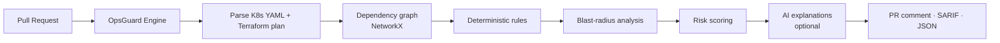

---
hide:
  - toc
---

# OpsGuard

### Catch the change before it breaks production.

Open-source production change intelligence for **Kubernetes & Terraform**.
OpsGuard traces every infrastructure change in a pull request, scores the blast
radius with deterministic rules, and blocks the merge before anything reaches
prod.

[Get started](installation.md){ .md-button .md-button--primary }
[View on GitHub](https://github.com/mehwish786jnc/OpsGuard){ .md-button }

## Explore the docs

-   :material-download:{ .og-ic } __Installation__

    ---

    Install from PyPI or source, with or without the optional AI extra.

    [:octicons-arrow-right-24: Install OpsGuard](installation.md)

-   :material-console-line:{ .og-ic } __Usage__

    ---

    Scan manifests and Terraform plans, gate the build, pick an output format.

    [:octicons-arrow-right-24: Run a scan](usage.md)

-   :material-source-pull:{ .og-ic } __GitHub Action__

    ---

    Post a sticky PR report, upload SARIF, and gate merges on severity.

    [:octicons-arrow-right-24: Add to CI](github-action.md)

-   :material-shield-check:{ .og-ic } __Rules__

    ---

    19 deterministic security & reliability checks across both ecosystems.

    [:octicons-arrow-right-24: Browse rules](rules.md)

-   :material-robot-outline:{ .og-ic } __AI explanations__

    ---

    Offline, Ollama or Gemini — explanations only, never risk decisions.

    [:octicons-arrow-right-24: How AI is used](ai.md)

-   :material-sitemap-outline:{ .og-ic } __Architecture__

    ---

    The parse → graph → rules → blast radius → score → report pipeline.

    [:octicons-arrow-right-24: Under the hood](architecture.md)

## Why OpsGuard?

Passing CI does **not** mean a change is safe for production. A perfectly
"green" pull request can still:

!!! danger "Public exposure"
    Expose an internal service to the internet, or open a security group to
    `0.0.0.0/0`.

!!! danger "Data loss"
    Delete or replace a production database, or remove a secret another service
    depends on.

!!! warning "Weak guardrails"
    Ship a workload with no probes or resource limits, or grant `*:*` IAM
    permissions.

Generic AI reviewers look at code. **OpsGuard understands what an infrastructure
change can break across your whole environment** — and it does so with
*deterministic rules*, not a coin-flipping LLM.

!!! info "Design principle"
    Security decisions are made by deterministic rules. AI is used only to
    *explain* findings and suggest fixes — never to decide whether a deployment
    is safe.

## How it works

1. **Parse** Kubernetes manifests and Terraform plan JSON.
2. **Graph** the relationships between Deployments, Services, Ingress, Secrets,
   ConfigMaps and cloud resources.
3. **Evaluate** deterministic security & reliability rules.
4. **Propagate** blast radius: a risky Secret change is reported *with* every
   service that depends on it.
5. **Score & explain**, then report in the format your pipeline needs.
