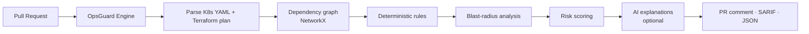

# 🛡️ OpsGuard

### Catch the change before it breaks production.

**Open-source production change intelligence for Kubernetes & Terraform.**

OpsGuard reviews infrastructure changes in a pull request, finds the ones that
could take down production — public exposure, destructive changes, insecure
config, missing reliability guardrails — explains the blast radius, and reports
back in the PR *before* anything is merged.

---

## Why OpsGuard?

Passing CI does **not** mean a change is safe for production. A perfectly
"green" pull request can still:

- 🌐 Expose an internal service to the internet
- 💥 Delete or replace a production database
- 🔓 Open a security group to `0.0.0.0/0`
- ⚙️ Ship a workload with no probes or resource limits
- 🔑 Grant `*:*` IAM permissions
- 🧩 Remove a secret another service depends on

Generic AI reviewers look at code. **OpsGuard understands what an infrastructure
change can break across your whole environment** — and it does so with
*deterministic rules*, not a coin-flipping LLM.

!!! info "Design principle"
    Security decisions are made by deterministic rules. AI is used only to
    *explain* findings and suggest fixes — never to decide whether a deployment
    is safe.

## How it works

1. **Parse** Kubernetes manifests and Terraform plan JSON.
2. **Graph** the relationships between Deployments, Services, Ingress, Secrets,
   ConfigMaps and cloud resources.
3. **Evaluate** deterministic security & reliability rules.
4. **Propagate** blast radius: a risky Secret change is reported *with* every
   service that depends on it.
5. **Score & explain**, then report in the format your pipeline needs.

## Next steps

- [Install OpsGuard](installation.md)
- [Run your first scan](usage.md)
- [Add it to GitHub PRs](github-action.md)
- [Browse the rules](rules.md)
